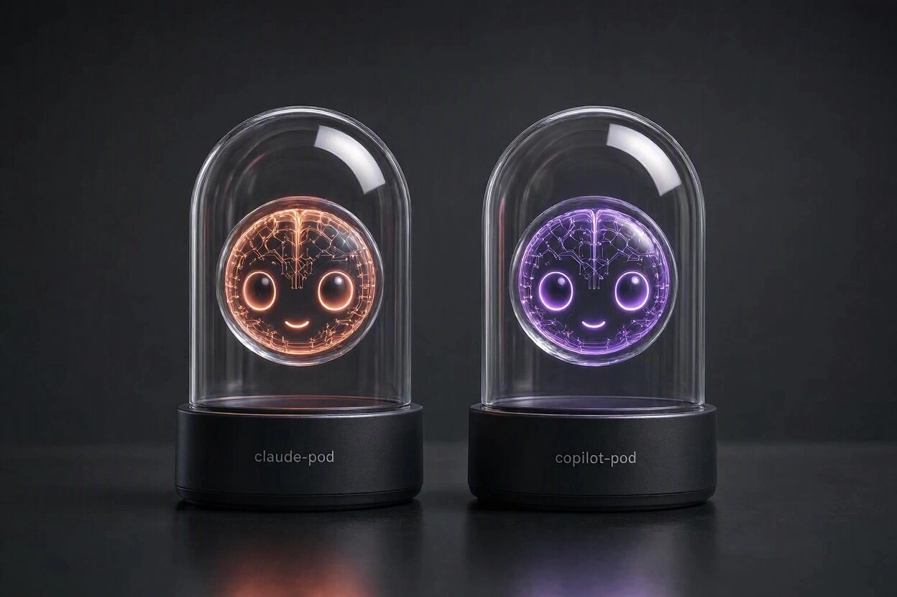

# ai-agent-pods

[](https://opensource.org/licenses/MIT)
[](https://github.com/alfsch/ai-agent-pods/stargazers)
[](https://github.com/alfsch/ai-agent-pods/issues)
[](https://github.com/alfsch/ai-agent-pods/network)
[](https://github.com/alfsch/ai-agent-pods/graphs/contributors)

> Docker sandbox for AI coding agents: [Claude Code](https://www.anthropic.com/claude-code) and the [GitHub Copilot CLI](https://docs.github.com/copilot/how-tos/use-copilot-agents/use-copilot-cli), one launcher for both. Runs the agent against one project folder, so your home directory, SSH keys and other projects stay invisible to the container. Unofficial.



## TL;DR

`agent-pod` runs an agent inside a Docker container that mounts the project folder you launch it from. The agent can read and edit that folder; the rest of your machine (home directory, SSH keys, other projects, host shell) is not mounted. The image of an agent contains only that agent: `agent-pod:claude` has Claude Code, `agent-pod:copilot` has Copilot CLI.

It is not full isolation:

- ✅ **Outside the launch folder is unreachable.** `~/.ssh`, `~/.aws`, other projects and the host shell are not mounted.
- ⚠️ **Inside the launch folder is fully exposed.** Any `.env`, `.git/config` or keys in it are readable and writable, outbound network is open, and the agent's login is stored on the host (`~/.claude-pod/`, `~/.copilot-pod/`).
- 🚫 **Don't launch from `~` or `/` or other sensitive folders.** That mounts your whole home or filesystem and defeats the point.

```sh
# Clone once, anywhere (~/tools/ai-agent-pods is an example)
git clone https://github.com/alfsch/ai-agent-pods.git ~/tools/ai-agent-pods

# Build the images (optional: a missing image is built on first start)
~/tools/ai-agent-pods/install.sh            # both agents; or: install.sh claude | copilot

# cd into your project, then launch an agent
cd ~/projects/your-project
~/tools/ai-agent-pods/agent-pod claude claude --dangerously-skip-permissions
~/tools/ai-agent-pods/agent-pod copilot copilot --yolo

# A shell in the pod instead (the agent is on PATH): leave out the command
~/tools/ai-agent-pods/agent-pod claude

# Docker inside the pod (rootless sidecar), with a cache that survives the session
DOCKER=1 DOCKER_CACHE=1 ~/tools/ai-agent-pods/agent-pod claude

# A copy-pastable cheatsheet
~/tools/ai-agent-pods/agent-pod --help
```

Docker is the only requirement: no Node.js, npm or agent needed on your host.

## Usage

### Choosing the agent

The first argument names the agent (`claude`, `copilot` or `goose`); the rest is the command to run in the container, a bash shell when empty. The repo also contains three symlinks, `claude-pod`, `copilot-pod` and `goose-pod`: called by one of these names, the launcher picks that agent and takes no agent argument.

```sh
alias claude-pod=~/tools/ai-agent-pods/claude-pod
alias copilot-pod=~/tools/ai-agent-pods/copilot-pod
alias goose-pod=~/tools/ai-agent-pods/goose-pod
claude-pod claude --dangerously-skip-permissions     # note: the command is still the command
```

### Images: install, update, pin

`install.sh [claude|copilot|goose|all]` builds `agent-pod:<agent>` from `Dockerfile` on top of one shared **base image** (`Dockerfile.base`: the tools, no agent), so each further image costs only the agent itself (an npm package, or for goose one static binary). A missing image is built by the launcher itself on the first start, so installing is optional.

**The base image** is published by CI to `ghcr.io/alfsch/agent-pod-base`, tagged with a hash of `Dockerfile.base` and `pod-environment.md`, for amd64 and arm64. `install.sh` pulls it, which saves the minute or two the tools take to build. If the pull fails (offline, a registry rate limit) it uses a local copy of that tag, and without one it builds the base itself from `Dockerfile.base`. `AGENT_POD_BUILD_BASE=1 ./install.sh` always builds it locally, which is the way to run only what you have read; `AGENT_POD_BASE_REPO=registry/path` points at another registry path (a fork). Only the base is published: Claude Code and Copilot CLI are proprietary, so each agent, goose included, is always installed by your own build.

**Signature.** CI signs the published base keylessly with [cosign](https://docs.sigstore.dev/cosign/overview/) (Sigstore): the signature ties the image digest to `publish-base.yaml` on `main` of this repository. When `cosign` is installed, `install.sh` verifies a pulled base and, if the check fails, does not use that image but builds the base itself; without `cosign` it says that the base is not verified and uses it. `AGENT_POD_REQUIRE_SIGNED_BASE=1` refuses a pulled base that cannot be verified, a missing `cosign` included. By hand:

```sh
cosign verify ghcr.io/alfsch/agent-pod-base:<tag> \
  --certificate-oidc-issuer https://token.actions.githubusercontent.com \
  --certificate-identity-regexp '^https://github.com/alfsch/ai-agent-pods/\.github/workflows/publish-base\.yaml@refs/heads/main$'
```

The signature proves where the image was built, not that the build is free of problems: it is as trustworthy as `main` and the workflow, so `AGENT_POD_BUILD_BASE=1` stays the way to run only what you have read. A base from another registry path (`AGENT_POD_BASE_REPO`) is not checked.

| | Claude Code | Copilot CLI | goose |
|---|---|---|---|
| Pin a version | `CLAUDE_CODE_VERSION=2.0.0 ./install.sh claude` | `COPILOT_CLI_VERSION=2.0.0 ./install.sh copilot` | `GOOSE_VERSION=1.56.0 ./install.sh goose` |
| Default channel (auto-updated) | npm `stable` | npm `latest` | latest [GitHub release](https://github.com/aaif-goose/goose/releases) |
| Newest build | `CLAUDE_CODE_VERSION=latest ./install.sh claude` | (the default) | (the default) |
| State on the host | `~/.claude-pod/` | `~/.copilot-pod/` | `~/.goose-pod/` |
| Variables forwarded | none | `COPILOT_GITHUB_TOKEN`, `GH_TOKEN`, `GITHUB_TOKEN` | `GOOSE_PROVIDER`, `GOOSE_MODEL`, `ANTHROPIC_API_KEY`, `OPENAI_API_KEY`, `GOOGLE_API_KEY`, `OPENROUTER_API_KEY` |

goose is installed from the static (musl) Linux binary of the release, which runs on any base; the download is over HTTPS from GitHub and is not checksummed, as the releases carry no checksum file. Its config, data and state all live in `~/.goose-pod/` (inside it: `config/goose/config.yaml`, `data/goose/sessions/`). The pod has no keyring, so secrets entered with `goose configure` are stored in plain text in `config/goose/secrets.yaml` there (mode 700 directory, as for the other agents); the forwarded provider variables are the alternative. goose has no self-updater to switch off, and no single config file, so it has no config file under `~/.config/agent-pod/`. Only the three directories it uses in `~/.agents` (which is read-only in the image, so goose could not write there) are persisted: `skills`, `plugins` and `agents`, in `~/.config/agent-pod/goose-skills/`, `goose-plugins/` and `goose-agents/`, outside the pod-writable state dir for the same reason as the config files below. Claude Code and Copilot CLI get the same for the shared global skills directory, `~/.agents/skills`, in `~/.config/agent-pod/<agent>-skills/` (they keep their own skills in their state dirs as before).
**Automatic updates on start:** two checks, both best-effort (offline or failed: a note, and the existing image is used).
- *The repository changed.* The image carries a hash of the Dockerfile and the files it copies. When it differs from the repo's (after a `git pull`, a Renovate update, your own edit of the Dockerfile), the image is rebuilt before the pod starts, with the version or channel it was built with. A start with a rebuild takes a minute or two. A base image that CI has rebuilt (weekly, for Debian security fixes) is picked up the next time an image is built; when the base is built locally, `install.sh` first pulls the `node:24-slim` image it starts from and, if that fails, builds on the local copy.
- *A newer agent release.* An image built from the default channel is compared with the current version on npm (for goose: the latest GitHub release) (3-second timeout) and rebuilt via `install.sh` when it is behind. Pinned images are never updated this way.

 Skip the check with `AGENT_POD_NO_UPDATE=1` (the old `CLAUDE_POD_NO_UPDATE` and `COPILOT_POD_NO_UPDATE` still work, each for its own agent).

### First launch (login)

Run `/login` in Claude Code or Copilot CLI (`goose configure` in goose) and follow the prompt. The session persists in the agent's state dir and survives restarts, once per machine. The dirs keep the names of the single-agent tools ([claude-pod](https://github.com/trekhleb/claude-pod), copilot-pod), so existing logins carry over. For Copilot you can export a token on the host instead; it is then visible to everything in the container.

### Where settings live

Everything is on the host, once for all projects, and you change it by editing the files there:

| What | Claude Code | Copilot CLI | goose |
|---|---|---|---|
| Login, settings, session history | `~/.claude-pod/` | `~/.copilot-pod/` | `~/.goose-pod/` |
| Account binding, project trust state | `~/.config/agent-pod/claude.json` | `~/.config/agent-pod/copilot.json` | (inside `~/.goose-pod/`) |
| Global skills in `~/.agents/skills` (goose also plugins) | `~/.config/agent-pod/claude-skills/` | `~/.config/agent-pod/copilot-skills/` | `~/.config/agent-pod/goose-skills/` (and `goose-plugins/`, `goose-agents/`) |

The config files are under `$XDG_CONFIG_HOME` if that is set. They are deliberately not in the state dirs (see [Side effects](#side-effects-outside-the-project-folder)). `agent-pod --help` prints the paths. Launcher options such as `DOCKER=1` are not stored anywhere: set them per run, or in an alias.

### Options

All of them are environment variables in front of the launcher:

| Variable | Effect |
|---|---|
| `PORTS="3000 5173"` | publish ports on `127.0.0.1` (`8080:80` maps a host port to another container port). Bind dev servers to `0.0.0.0` inside the container. |
| `NET=none` | no network at all (offline build/inspect work; the agent itself cannot reach its API then). Excludes `PORTS` and `DOCKER=1`. |
| `MEMORY=4g CPUS=2 PIDS=512` | resource limits (`PIDS` defaults to 4096) |
| `DOCKER=1` | a throwaway rootless Docker daemon for the session (see below) |
| `DOCKER_CACHE=1` | keep that daemon's images between sessions, one cache per project |
| `DOCKER_CACHE_MAX_AGE_DAYS=30` | prune caches unused for that long (default 90, 0 = never) |
| `DIND_IMAGE=...` | another sidecar image (pin by digest) |
| `AGENT_POD_GITCONFIG=~/.gitconfig-work` | the git config used as the pod's global one (see below); must be a file |
| `AGENT_POD_SKILLS_DIR=~/skills` | a host folder of skills (`<name>/SKILL.md`), mounted read-only as one skill each into the agent's personal skills dir; see below |

**Git identity.** The pod's home is thrown away, so git has no name or email in it and commits fail with "Author identity unknown". Put a git config with just the identity (author and committer both come from it) in `~/.config/agent-pod/gitconfig`:

```ini
[user]
    name = Your Name
    email = you@example.com
```

The launcher mounts it read-only as `~/.gitconfig`. For another identity per agent use `~/.config/agent-pod/<agent>.gitconfig`, which wins over the shared file; for another one per project or session use `AGENT_POD_GITCONFIG` (it wins over both, and an override that is not a file stops the launcher instead of falling back to another identity; a file in the project folder or in a directory the pod can write is refused too, because the pod could swap it for a symlink to a host file). Without any of them nothing is mounted. Whatever the file contains is visible to the pod, so keep to the identity: no credential helpers or tokens. A symlink you make there is followed.

### Using Docker inside the pod

`DOCKER=1` starts a separate **rootless Docker-in-Docker sidecar** (a pinned `docker:<major>-dind-rootless` image) on a private per-run network and points the pod's `docker` CLI (with Compose and Buildx) at it. Only the sidecar is `--privileged`; the pod keeps all its hardening (no capabilities, `no-new-privileges`, default seccomp). The host's Docker socket is never mounted. The daemon accepts only a per-run client certificate (mutual TLS). Sidecar, network and certificates are removed when the session ends. Use it on projects you trust: an escape from the privileged sidecar would be more serious than from the default pod.

- If your default Docker daemon is rootless (see "Rootless Docker" below), `DOCKER=1` needs a rootful daemon at `unix:///var/run/docker.sock`: the sidecar cannot run inside a rootless daemon, which maps too few ids and would not let the sidecar write the project folder. The launcher then uses that daemon for the whole session and prints a notice; if none answers, it stops. Your user needs access to the socket, which is root-equivalent on the host.
- On Linux the rootless daemon needs unprivileged user namespaces. Ubuntu 24.04+ restricts them through AppArmor; the sidecar then fails with `rootlesskit ... operation not permitted`. Check `sysctl kernel.apparmor_restrict_unprivileged_userns`; if it is `1`, set it to `0` (`sudo sysctl -w kernel.apparmor_restrict_unprivileged_userns=0`, permanent via `/etc/sysctl.d/`). This loosens the restriction machine-wide.
- On Linux with a host uid other than 1000 the launcher builds a small sidecar image once (`agent-pod-dind:*`) whose user has your uid, so inner containers running as root can write to the project as you. Inner containers running as another user cannot, unless the folder is group-writable.
- The project folder is mounted into the sidecar at the same path, so `docker run -v "$PWD:/app" ...` works. The rootless daemon has no cgroups, so `docker run --memory/--cpus` inside has no effect; `MEMORY`, `CPUS` and `PIDS` limit the sidecar as a whole.
- Ports published by inner containers live on the sidecar's network: from the pod reach them at `dind:<port>`.
- To cancel a `DOCKER=1` launcher running in the background (`agent-pod ... &`), send SIGTERM (`kill $!`); non-interactive shells start background jobs with SIGINT ignored.

**Keeping images between sessions.** `DOCKER=1 DOCKER_CACHE=1` keeps the sidecar's data in the named volume `agent-pod-docker-<16 hex chars of sha256(project path, sidecar uid:gid)>`: **one cache per project, shared by both agents.** You see `Docker cache: created new ...` or `reusing ... (N images, SIZE)`. Only one session per project can use the cache at a time; a second stops with a message (a leftover after `kill -9` is removed with the `docker rm -f` command it prints). Whatever a session pulled or built, including anything malicious or secret, is there in the next one, and inner containers started with `--restart=always` are started again by the daemon in the next session of that project: skip the cache for untrusted code. Last-use markers for pruning live in `~/.local/state/agent-pod/caches/` (or under `$XDG_STATE_HOME`), outside the dirs the pod can see.

The design, the lifecycle invariants and how to test it: [docs/docker-sidecar.md](docs/docker-sidecar.md).

### Pasting images and screenshots

The agent only sees files inside the project folder. Copy the screenshot into the project (e.g. a `tmp/` subfolder), copy it again from there so that the path on your clipboard is the in-project one, then paste.

### Customizing the image

Intentionally minimal: `node:24-slim` + `git` + `curl` + `less` + `jq` + `gh` + `yq` + the `docker` CLI (+ compose, buildx) + `python3` + `pip` + `venv` + `pdftotext` + `qpdf` + `tesseract` (English, German) + the agent. Anything else your projects need you add yourself: edit `Dockerfile.base` (the tools; build it locally with `AGENT_POD_BUILD_BASE=1 ./install.sh`, as the published base does not have your change) and re-run `install.sh`. Claude Code and Copilot CLI are told what is in the image, and what is not possible in the container (no root, Docker only with `DOCKER=1`), by [`pod-environment.md`](pod-environment.md), which the image carries where each tool reads it. Keep its "Tools on PATH" line in line with the Dockerfile; the integration tests check every tool on it.

## Security and limits

### What it actually does

- **`agent-pod`**: one `docker run` that mounts your current directory and the agent's state dir, and nothing else of your machine. Run as `claude-pod` / `copilot-pod` / `goose-pod` it is the same script.
- **`Dockerfile.base`**: the tools above, published as the base image by `.github/workflows/publish-base.yaml`. **`Dockerfile`**: the agent on top of it; `AGENT_PKG`/`AGENT_VERSION` build args select the agent.
- **`install.sh`**: checks Docker and builds the images; it does not touch any system path.
- **`uninstall.sh`**: removes the images, the cache volumes, the sidecar images, both state dirs and the config dir after confirmation. With a rootless default daemon it also cleans the rootful daemon at `/var/run/docker.sock`, where `DOCKER=1` sessions run (see "Using Docker inside the pod").

The container runs as your uid:gid with `--cap-drop=ALL`, `no-new-privileges` and `--rm`, and a process cap.

**Rootless Docker.** A rootless daemon maps your host user to container root, so the state dir you mount shows up as `root:root` (mode 700) and a pod running as your uid could not read it (symptom: "credentials could not be saved"). The launcher detects a rootless daemon (`docker info` shows `rootless`) and runs the pod as uid 0 instead, which is still you on the host; capabilities stay dropped. Two consequences: files the pod creates belong to you as usual, and the agent runs as root inside the container. Claude Code refuses `--dangerously-skip-permissions` as root, so in that case the launcher sets `IS_SANDBOX=1` (its signal that it already runs in a sandbox, which the pod is); other agents get nothing. `DOCKER=1` is covered in the section above.

### What is and isn't isolated

**Safe from the agent:** everything outside the project folder (`~/.ssh`, `~/.aws`, shell rc files, browser data, other projects) and the host shell.

**Still exposed:**
- **The project folder itself**: `.env`, `.git/config` (may carry credentials for private remotes), keys committed by mistake, `node_modules`, sibling worktrees. Don't run it in a folder whose contents you would not trust the AI, or a malicious dependency it installed, to see and modify.
- **The network**: outbound is open by default, so contents can be exfiltrated and API quota burned. `NET=none` cuts it, and the agent itself with it; there is no egress allowlist.
- **The agent's login**, stored in `~/.claude-pod/`, `~/.copilot-pod/` or `~/.goose-pod/` (separate from any host install, shared across projects).
- **Shared state links your projects.** The state dirs and the config file are the same for every project, and the pod can write to them. Code running in project A (a prompt-injected agent, a malicious dependency) can leave a hook, a command, an MCP server entry or instructions there, and the agent runs it in your next session in project B, with B mounted. So "other projects are unreachable" holds for files, not for the agent's own settings. If you work with untrusted code, give it its own copy of the state: run it with another `HOME` (`HOME=~/untrusted agent-pod claude ...` uses `~/untrusted/.claude-pod` and `~/untrusted/.config/agent-pod`), and delete that directory afterwards.

**Where the agent can write**, all intentional bind mounts: the project folder (`$PWD:$PWD`), the agent's state dir (`~/.claude-pod` → `/home/agent-pod/.claude`, `~/.copilot-pod` → `/home/agent-pod/.copilot`) and its config file (`~/.config/agent-pod/claude.json` or `copilot.json` → `/home/agent-pod/.claude.json` or `.copilot.json`). Everywhere else is the container's ephemeral filesystem. Symlinks in the project pointing outside it appear broken. **Hardlinks are different:** a hardlink inside the project to a sensitive file on the same filesystem exposes that inode, so be careful with projects from untrusted sources.

**Extra skills.** `AGENT_POD_SKILLS_DIR` names a host folder whose sub-folders each hold a `SKILL.md`. Every one is mounted read-only as `<name>` in the agent's personal skills dir (`~/.claude/skills` for Claude Code, `~/.copilot/skills` for Copilot CLI, `~/.agents/skills` for goose), so the pod cannot change your copy and a `git pull` there shows up in the next session. It must be a directory with at least one skill, or the launcher stops. It also stops if a skill is in, or contains, a folder the pod can write (the project folder, the agent's state dir, the dirs mounted from `~/.config/agent-pod`), because the pod could then change the skill through that path although the mount is read-only; a symlinked skill folder counts by where it really is. On the host these sit in `~/.claude-pod/skills/`, `~/.copilot-pod/skills/` and `~/.config/agent-pod/goose-skills/`. The launcher creates that folder if it is missing, so it is owned by you; Docker leaves an empty `<name>` folder in it as the mount point, owned by root, which you can remove. A skill of your own with the same name there is hidden while the variable is set. The skills the account syncs (`synced/`) are not affected.

### Side effects outside the project folder

- `~/.claude-pod/`, `~/.copilot-pod/` and `~/.goose-pod/`: auth, settings, session history (transcripts can contain code and command output the agent saw).
- `~/.config/agent-pod/claude.json` and `copilot.json` (under `$XDG_CONFIG_HOME` if set): the agent's account binding and project trust state, one file per agent for all projects. Edit them there. They are outside the state dirs on purpose: the pod can write to a state dir, and a symlink it left in place of the file would make the launcher and Docker follow it to a host file. The pod gets the file, not its directory. If you used the single-agent claude-pod or copilot-pod before, copy its `.claude.json` or `.copilot.json` from the state dir to that path to keep the trust state (login credentials stay in the state dir).
- `~/.config/agent-pod/gitconfig` and `<agent>.gitconfig` (or the file named by `AGENT_POD_GITCONFIG`): only read, never written, and mounted read-only.
- `~/.claude-pod/skills/<name>/`, `~/.copilot-pod/skills/<name>/` or `~/.config/agent-pod/goose-skills/<name>/`: empty mount-point folders for the skills of `AGENT_POD_SKILLS_DIR`. The skills themselves are only read, mounted read-only.
- Docker images `agent-pod:claude`, `agent-pod:copilot`, `agent-pod:goose`, the base image `ghcr.io/alfsch/agent-pod-base:*` and the `node:24-slim` image it is built from; with `DOCKER_CACHE=1` one `agent-pod-docker-*` volume per project; with `DOCKER=1` on a Linux host whose uid is not 1000 an `agent-pod-dind:*` image; Docker build cache. Pruning markers in `~/.local/state/agent-pod/caches/`.
- Outbound network during build (ghcr.io for the base image, Docker Hub, apt mirrors, npm) and at runtime (the agent's API, whatever your code reaches).

No `sudo`, no writes to `/usr/local`, `/etc`, shell rc files, or your existing `~/.claude/` / `~/.copilot/`.

## Contributing

Rules for people and AI agents are in [`AGENTS.md`](AGENTS.md). Run `tests/check.sh` (syntax, ShellCheck, stub tests
with mutants) before a pull request; CI runs the same steps.

## Reference

### Platforms

Portable bash + Docker: macOS (Docker Desktop, OrbStack, Colima), Linux, Windows with WSL2 (run it from inside a WSL distribution). Native Windows is not supported. The launcher runs under the macOS system Bash 3.2.

### Uninstall

```sh
~/tools/ai-agent-pods/uninstall.sh
```

Lists what it removes (the images, the base image tags too) and what it leaves (the `node:24-slim` image, build cache, this repo, your shell aliases) and asks first.

### License and trademarks

MIT, see [`LICENSE`](LICENSE). The cover image was generated with AI (Microsoft Bing Image Creator). Derived from [trekhleb/claude-pod](https://github.com/trekhleb/claude-pod) by Oleksii Trekhleb (MIT); the Copilot CLI and unified-launcher parts are by Alfred Schmid.

Claude Code is a product of Anthropic, PBC; Copilot CLI of GitHub, Inc. (Microsoft); goose is an open-source project (Apache-2.0) of the Agentic AI Foundation, formerly Block. None is redistributed here: `install.sh` fetches them from npm (goose: from its GitHub releases) at build time. This project is not affiliated with, endorsed by or sponsored by either company; their names are trademarks of their owners, used nominatively. No logos or brand assets are used.
